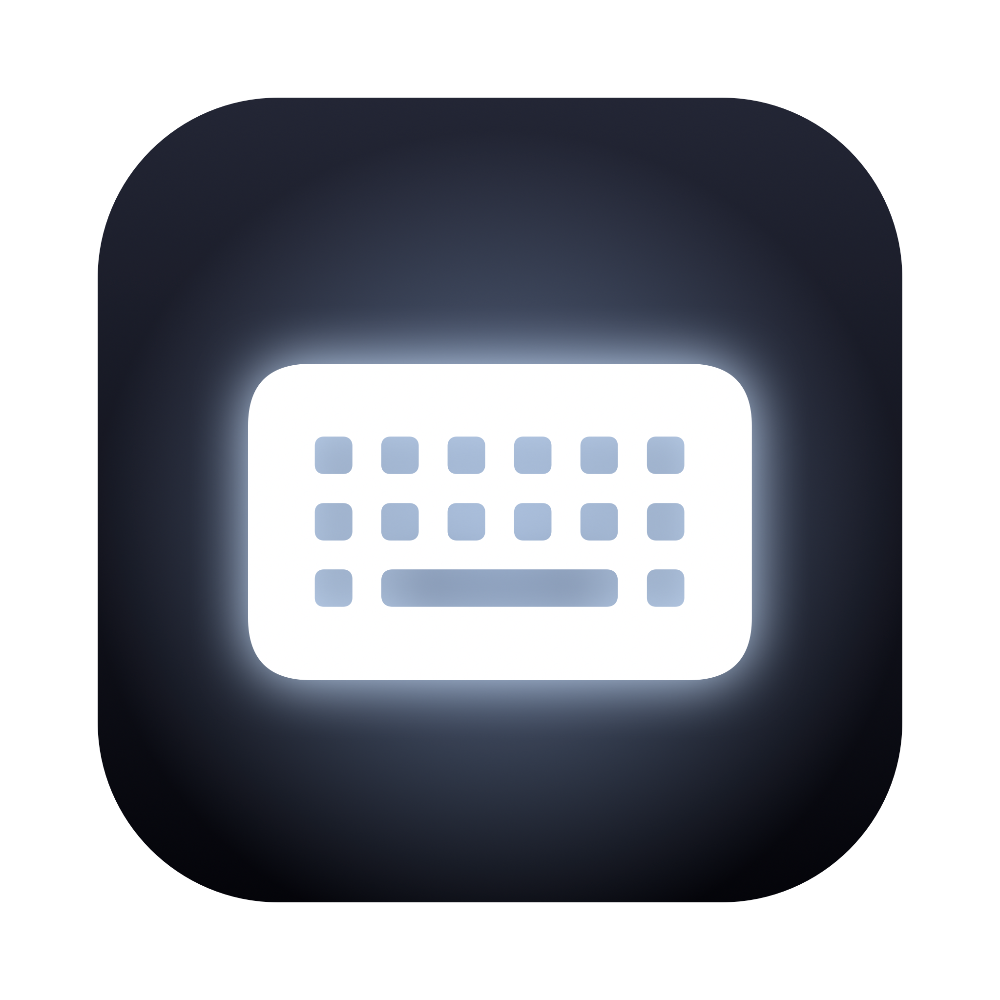

<p align="center"></p>
<h1 align="center">KeyGlow</h1>
<p align="center">Make your MacBook keyboard backlight breathe, flicker, pulse to music and blink secret messages.</p>

---

KeyGlow is a tiny menu bar app that animates the built-in keyboard backlight on a MacBook.

## Effects

| | Effect | What it does |
|---|---|---|
| 🌬️ | **Breathe** | Slow, calm fade in and out |
| ❤️ | **Heartbeat** | Lub-dub pulse |
| ⚡ | **Strobe** | Hard on/off flashing |
| 🕯️ | **Candle** | Warm, random flicker |
| 🌊 | **Ocean** | Rolling, layered waves |
| ⛈️ | **Storm** | Darkness with sudden lightning strikes |
| 🎵 | **Music** | Pulses to whatever the mic hears |
| ⌨️ | **Typing** | Flashes on every keystroke |
| 📡 | **Morse** | Blinks any message you type in Morse code |

Adjust speed and the brightness range with sliders. When you stop or quit, your keyboard goes back to exactly how it was.

## Install

1. Download **KeyGlow.zip** from the [latest release](../../releases/latest) and unzip it.
2. Drag **KeyGlow.app** into your Applications folder and open it.
3. KeyGlow isn't notarized by Apple, so macOS will block it the first time. Go to **System Settings → Privacy & Security**, scroll down, and click **Open Anyway**.
   - Or, in Terminal: `xattr -dr com.apple.quarantine /Applications/KeyGlow.app`
4. Click the ⌨️ icon in your menu bar.

**Requirements:** a MacBook with a backlit keyboard, macOS 13 Ventura or later. Works on both Apple Silicon and Intel Macs.

### Permissions
- **Music** asks for microphone access. Audio is only measured for loudness and is never recorded or sent anywhere.
- **Typing** needs Accessibility access (System Settings → Privacy & Security → Accessibility). It only notices *that* a key was pressed and never reads which key.

KeyGlow has no network code at all. The whole app is one Swift file, [`KeyGlow.swift`](KeyGlow.swift), so you can read it yourself.

## Build from source

```sh
git clone https://github.com/0xroachyeth/KeyGlow.git
cd KeyGlow
./build.sh
```

Requires Xcode or the Xcode Command Line Tools.

## How it works

macOS has no public API for the keyboard backlight. KeyGlow uses `KeyboardBrightnessClient` from Apple's private `CoreBrightness` framework, the same thing Control Center uses. That means a future macOS update could break it, and it can't be on the Mac App Store.

MacBook backlights are a single white zone, so effects change the brightness of the whole keyboard at once. No per-key RGB, sorry!

## License

MIT
